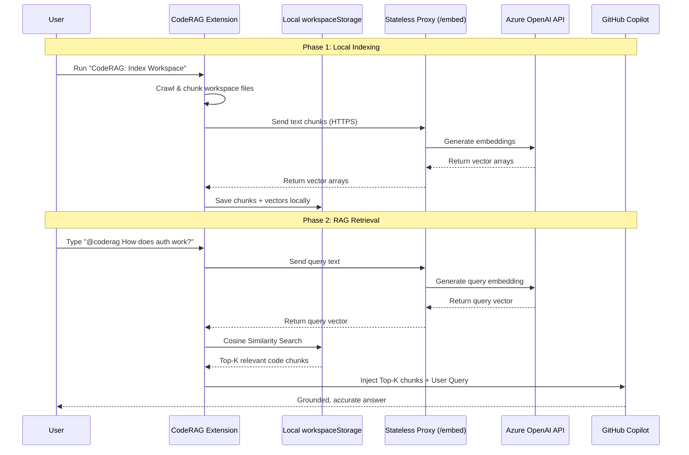

# CodeRAG: Solving Copilot's Contextual Blind Spot

## 1. The Core Problem
GitHub Copilot and other AI coding assistants are incredibly powerful at generating code within the scope of an active file. However, they suffer from a severe **contextual blind spot**: they struggle to understand the broader repository architecture.

When a developer asks a question like *"How do we handle database connections here?"*, standard Copilot only sees the currently open tabs. It lacks a holistic, semantic understanding of the entire codebase.

While enterprise solutions offer codebase indexing, they often require uploading the entire proprietary codebase to cloud servers, raising massive privacy and security concerns for organizations.

## 2. The CodeRAG Solution
**CodeRAG** (Code Retrieval-Augmented Generation) proves that this limitation can be solved **securely and locally**. By injecting a lightweight, privacy-first vector database directly into the VS Code extension host, CodeRAG acts as a "long-term memory" for Copilot.

It provides Copilot with exactly the right code snippets from anywhere in the repository, grounding AI generations in reality without exposing intellectual property.

## 3. The Privacy-First Architecture

CodeRAG operates on a strict **Local-First Pattern**. The system is divided into two parts: a stateless cloud proxy and a stateful local extension.

### A. The Stateless Cloud Proxy
Due to local computational limits (running heavy LLMs locally is slow and resource-intensive), CodeRAG uses a lightweight cloud backend (`coderag-backend-shyam.azurewebsites.net`).

Crucially, **this backend is 100% stateless.**
- It exposes a single `/embed` endpoint.
- It receives raw code chunks, forwards them to the **Azure OpenAI `text-embedding-3-small`** model, and returns numerical vectors (embeddings).
- **No data is stored.** No `.faiss` indices, no text files, no logs of the code are kept on the server.

### B. The Stateful Local Extension
All intellectual property remains on the developer's local machine.

1. **Local Chunking:** The VS Code extension crawls the local workspace, reading files directly from the disk. It splits these files into semantic chunks locally.
2. **Local Storage:** The numerical vectors returned by the cloud proxy are saved into a `coderag.index.json` file securely tucked into VS Code's local hidden storage (`workspaceStorage`).
3. **Local Retrieval:** When the developer uses `@coderag` or `#codeRagSearch`, the query is embedded, and a pure mathematical **Cosine Similarity** search is run strictly within the local TypeScript environment.
4. **Context Injection:** The highest-scoring code chunks are injected directly into Copilot's context window.

## 4. Technical Workflow

## 5. Advanced Features (v2.0)

### A. Smart Context Visualizer
The CodeRAG Intelligence Dashboard provides real-time transparency into the RAG pipeline. After every query, a rich webview panel displays exactly which files and code chunks were retrieved, along with cosine similarity scores and visual confidence bars. This transforms the system from a black box into a fully observable AI pipeline.

### B. Hallucination & Confidence Checker
Before presenting generated code to the developer, CodeRAG validates every import, function call, class reference, and decorator against the retrieved codebase context. The result is a structured confidence report with green (verified), yellow (warning), and red (error) indicators, directly addressing the trust problem in AI-generated code.

### C. Project Memory & Document Upload RAG
CodeRAG supports uploading external documentation (PDFs, READMEs, design docs) that get chunked, embedded, and merged into the retrieval pipeline. Combined with persistent query memory, CodeRAG builds a comprehensive understanding of both the code and its surrounding documentation, enabling truly context-aware AI assistance.

## 6. The Proof of Concept & Future Potential

With the current implementation, we have successfully proven that:
1. **The Context Problem is Solvable:** Providing Copilot with RAG-retrieved context drastically improves the accuracy of multi-file refactoring and architectural queries.
2. **Privacy Can Be Maintained:** By decoupling the *embedding generation* (cloud) from the *vector storage and search* (local), organizations do not need to choose between AI capabilities and code privacy.
3. **AI Trust is Achievable:** The Hallucination & Confidence Checker demonstrates that generated code can be systematically validated against real project context before being accepted.

### Scaling Up
Our current implementation uses small limits suitable for a Proof of Concept (e.g., small batch sizes and a lightweight embedding model). However, the architecture is designed to scale infinitely:

- **Local Embeddings:** As local hardware (like Apple Silicon and AI PCs) becomes more powerful, the stateless cloud proxy can be entirely replaced by on-device embedding models (e.g., ONNX runtime inside VS Code), achieving 100% zero-network exposure.
- **Enterprise Vector DBs:** While `coderag.index.json` is perfect for individual developers, the same architecture can easily swap out the local JSON file for a team-wide, securely hosted managed vector database (like Milvus or Pinecone) for enterprise scenarios.

## 7. Conclusion
CodeRAG bridges the gap between local editor intelligence and massive repository scale. By leveraging Azure OpenAI's embedding models through a stateless, privacy-first architecture and augmenting it with advanced features like confidence checking and document RAG, we have unlocked enterprise-grade AI capabilities within a highly constrained environment.
